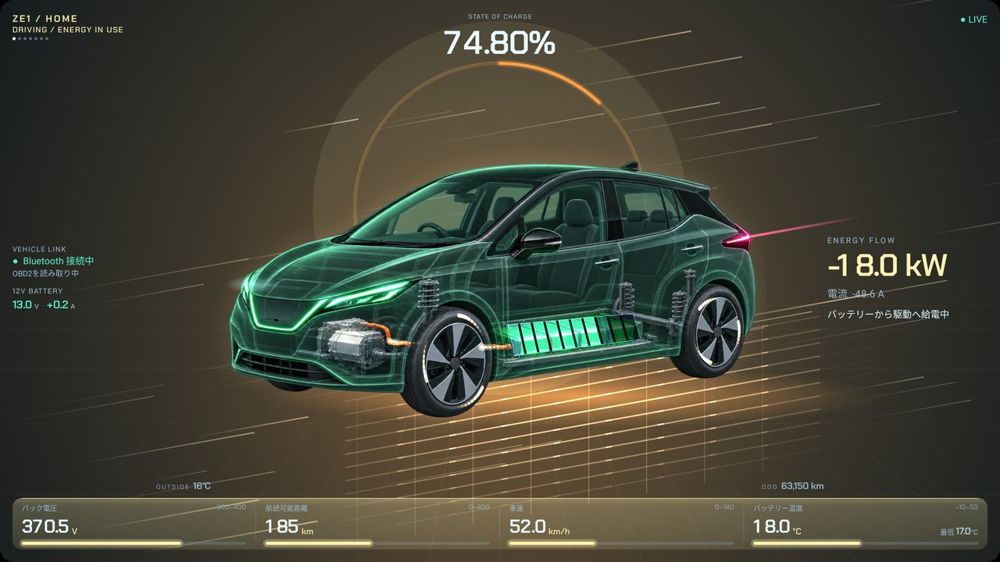
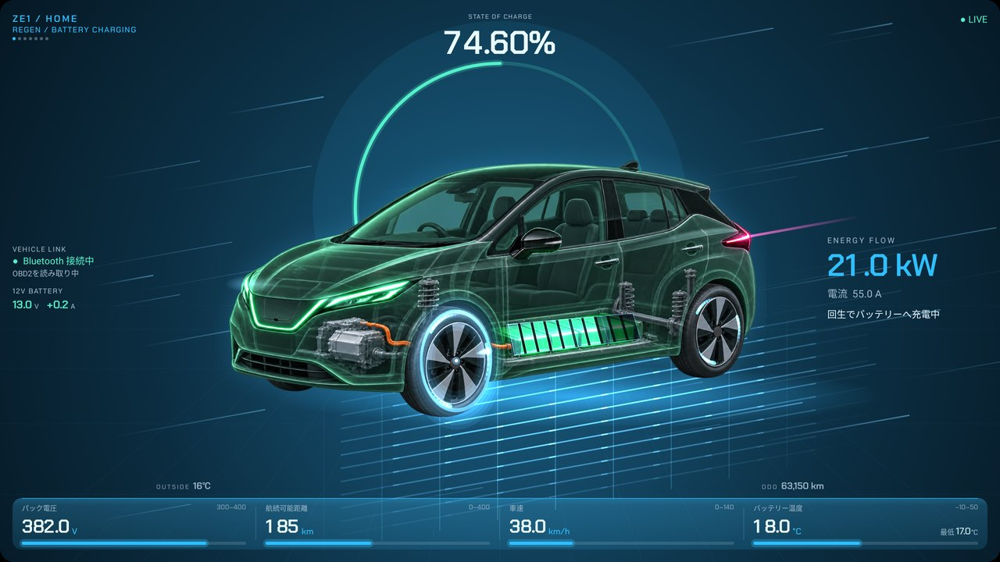
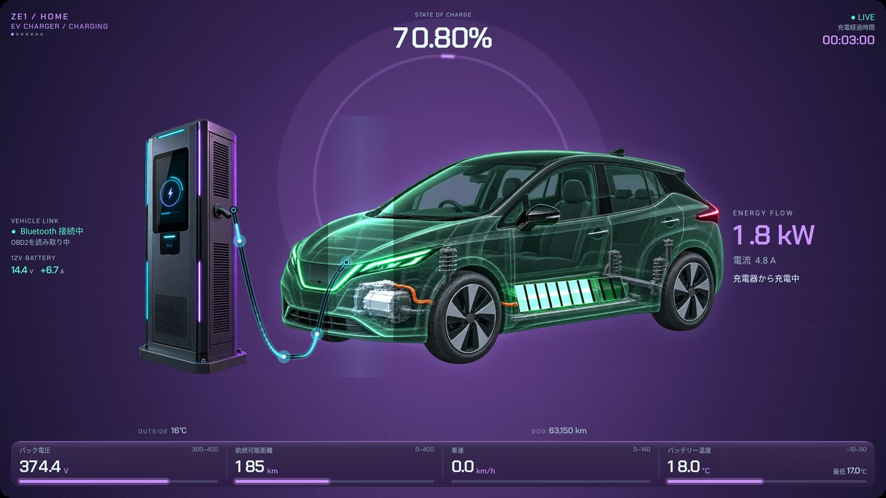
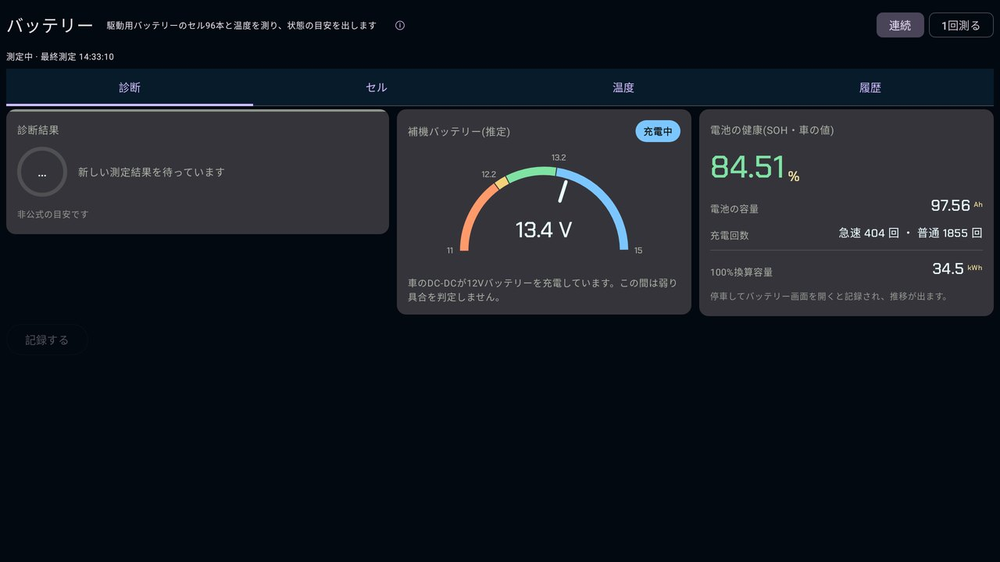
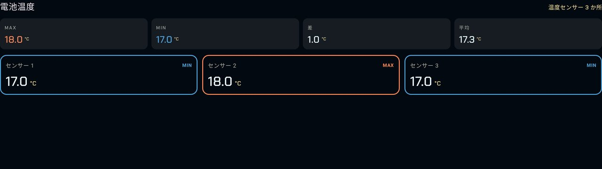

# ZE1 Monitor

A vehicle monitor app (Android) for the 2nd-generation Nissan Leaf (ZE1, model years 2017–2025).
This is an unofficial app made by an individual. It is not affiliated with Nissan.

[日本語](README.md)

## Features

- Home: actual SOC, power (including regen), pack voltage, speed, range, battery temperature, 12 V battery, outside temperature, odometer, ECO and e-Pedal on/off (the actual SOC is not the meter %; it is about 95% when full)
- Battery: SOH, capacity, the 96 cell voltages, battery temperatures, quick/normal charge counts, records and trends
- Charging view, trips, eco-driving challenge, milestones, threshold alerts (can also be spoken)
- Efficiency log by outside temperature
- Driving and charging records (CSV), demo mode, text size, Japanese, English and Traditional Chinese
- **ZESP3 minutes left (v0.1.3 and later, Japan only)**: ZESP3 is Nissan's charging plan in Japan. Turn on **ZESP3 minutes left** in Settings and save your Nissan ID and password, and the app shows the free fast and normal charging minutes left this month (off by default). After a fast charge the minutes are read again automatically. **ZESP READER** is built in with the author's permission. This is unofficial and may stop working if the site changes.

## Screens

Samples made with values from a real car's log.

| Driving | Regen |
|---|---|
|  |  |
| **Charging** | **Battery** |
|  |  |

## Requirements

- A phone, tablet or car head unit with Android 8.0 or later
- An ELM327-compatible OBD2 adapter (Bluetooth, BLE or Wi-Fi)

## Install

1. Download `ze1monitor-0.1.3.apk` from [Releases](https://github.com/kojipa/ze1monitor-releases/releases).
2. Open the file and install it (allow installing from this source if Android asks).
3. Plug the adapter into the car's OBD2 port, choose it in the app and connect.

## Not yet tested on a real car

This app is a test release. With 0.1.0 we confirmed that it connects to a real car (a 2018 40 kWh) and shows the values.
The following have not been checked on a real car yet:

- The display during quick charging
- The 62 kWh (e+)
- ZESP3 minutes left
- Model years and grades other than the 2018 40 kWh
- Driving and charging records, trips and alerts working correctly on a real car

Please send anything you notice through the report form in the app's settings.

## Notes

- The app sends read commands only. It never sends commands that change the car's settings.
- Do not operate the app while driving.
- **Only when ZESP3 minutes left is on**, the app connects to the ZESP3 and Nissan ID sites to read the minutes left. Your Nissan ID and password are stored encrypted on the device and used only to sign in. Turning the feature off deletes them. No vehicle data is sent.
- The survey app (ZE1 Monitor Survey) is a separate app; both can be installed at the same time.

## Disclaimer

- This is an unofficial app made by an individual. It is not affiliated with Nissan or its related companies in any way.
- The values shown are estimates based on what is read from the car, and their accuracy is not guaranteed. Rely on the car's own meter and dealer inspections when judging the car's condition.
- The author accepts no responsibility for any damage caused by using this app or an OBD2 adapter (including vehicle faults, a flat 12 V battery or accidents). Use at your own risk.
- Leaving an OBD2 adapter plugged in can drain the 12 V battery. Unplug it when not in use.

## References

How the values are read was based on these public sources (no code was copied):

- [OVMS v3](https://github.com/openvehicles/Open-Vehicle-Monitoring-System-3) (vehicle_nissanleaf, MIT License)
- [zerinrc/ze1tcu](https://github.com/zerinrc/ze1tcu) (MIT License)
- [dalathegreat/leaf_can_bus_messages](https://github.com/dalathegreat/leaf_can_bus_messages) (Nissan Leaf 2018 ECU polling)
