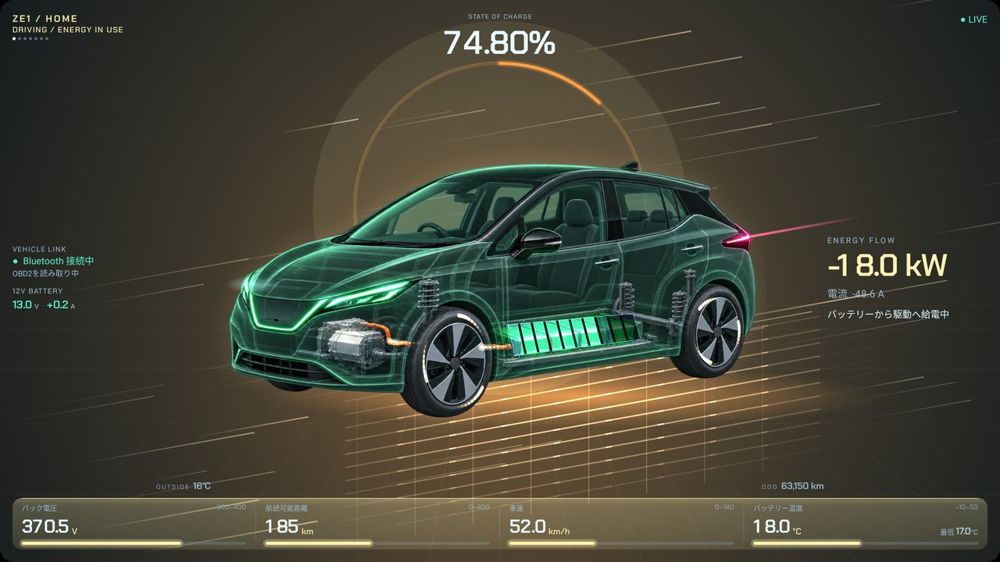
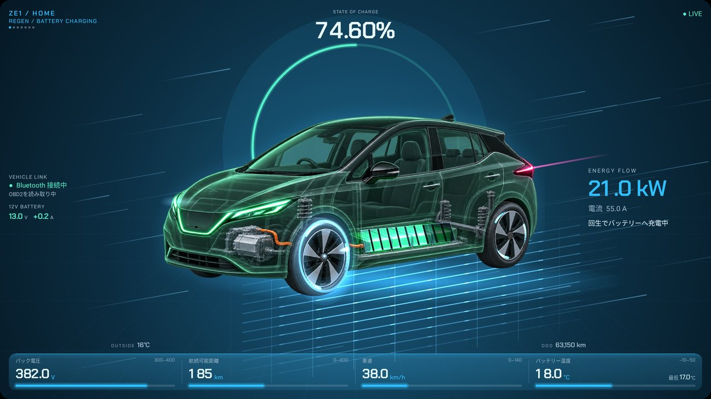
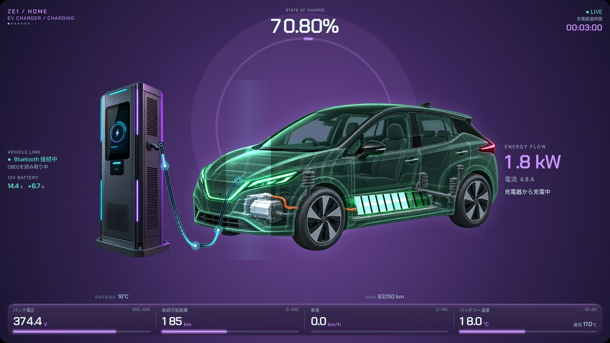
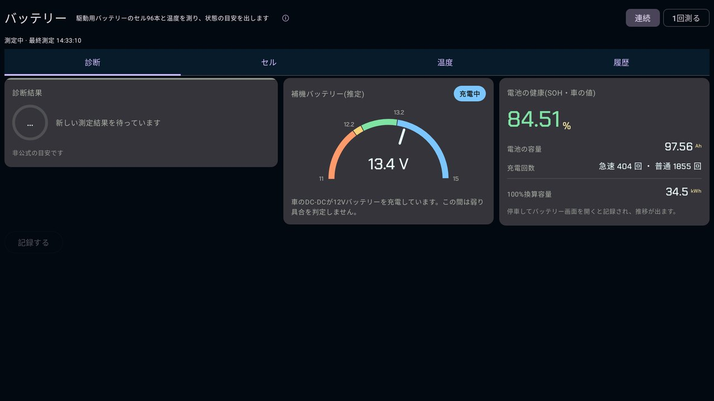
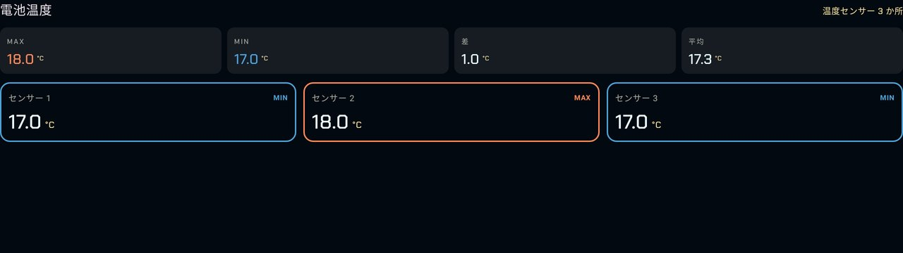

# ZE1 Monitor

2代目日産リーフ（ZE1、2017〜2025年式）用の車両モニターアプリ（Android）です。
日産自動車とは関係のない、個人が作った非公式のアプリです。

[English](README.en.md)

## できること

- ホーム画面：実SOC、出力（回生を含む）、パック電圧、車速、航続可能距離、電池温度、12Vバッテリー、外気温、走行距離、ECO・e-Pedal の ON/OFF（実SOC はメーターの%とは別の値で、満充電のときで約95%です）
- 電池画面：SOH、電池の容量、セル96本の電圧、電池温度、急速・普通充電の回数、記録と推移
- 充電中の表示、トリップ、エコ運転チャレンジ、キリ番、しきい値の通知
- 走行と充電の記録（CSV）、デモモード、文字の大きさ、日本語と英語

## 画面

実車の記録の値を使った見本です。

| 走行中 | 回生中 |
|---|---|
|  |  |
| **充電中** | **電池画面** |
|  |  |

## 必要なもの

- Android 8.0 以上のスマートフォン、タブレット、カーナビ（Android）
- ELM327 互換の OBD2 アダプター（Bluetooth、BLE、Wi-Fi）

## 入れ方

1. [Releases](https://github.com/kojipa/ze1monitor-releases/releases) から `ze1monitor-0.1.2.apk` をダウンロードします。
2. ダウンロードしたファイルを開いてインストールします（「提供元不明のアプリ」の許可を求められたら許可してください）。
3. アダプターを車の OBD2 端子に挿し、アプリでアダプターを選んで接続します。

## 実車で試していないこと

このアプリは試験版です。0.1.0 で、実車（2018年式 40kWh）につないで値が表示されることを確かめました。
次のことは、まだ実車で確かめていません。

- 急速充電中の表示
- 62kWh（e+）の車
- 2018年式 40kWh 以外の年式・グレード
- 走行と充電の記録、トリップ、通知などが実車で正しく動くこと

気づいたことは、アプリの設定にある報告フォームから送ってください。

## ご注意

- 車に送るのは読み取りの命令だけです。車の設定を変える命令は送りません。
- 運転中は操作しないでください。
- 調査版（ZE1 Monitor 調査版）とは別のアプリです。両方入れたまま使えます。

## 免責事項

- このアプリは個人が作った非公式のものです。日産自動車および関係会社とは一切関係ありません。
- 表示される値は車から読み取った値をもとにした目安で、正確さは保証しません。車の状態の判断は、車のメーターと販売店の点検を優先してください。
- このアプリや OBD2 アダプターの使用によって生じたいかなる損害（車両の故障、バッテリー上がり、事故など）についても、作者は責任を負いません。自己責任でご利用ください。
- OBD2 アダプターを挿したままにすると、12V バッテリーが減ることがあります。使わないときは抜いてください。

## 参考にした資料

車からの値の読み方は、次の公開資料を参考にしました（コードの複製はしていません）。

- [OVMS v3](https://github.com/openvehicles/Open-Vehicle-Monitoring-System-3)（vehicle_nissanleaf、MIT License）
- [zerinrc/ze1tcu](https://github.com/zerinrc/ze1tcu)（MIT License）
- [dalathegreat/leaf_can_bus_messages](https://github.com/dalathegreat/leaf_can_bus_messages)（Nissan Leaf 2018 ECU polling）
